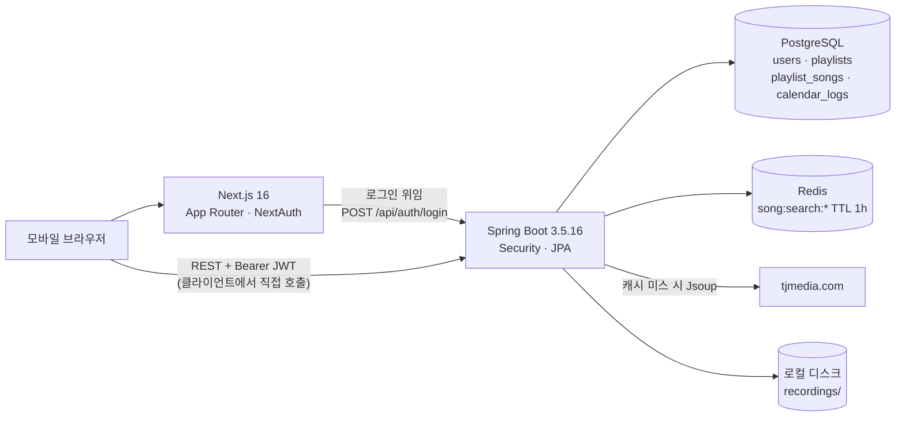
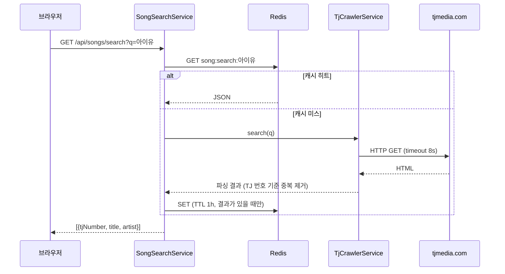
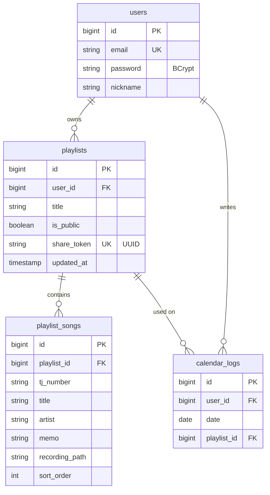

# KonoList (코노리스트)

코인 노래방에서 부를 노래를 TJ 번호와 함께 미리 정리해 두고, 친구와 공유하고, 다녀온 날을 캘린더에 남기는 모바일 웹 서비스입니다.

[🔗 소개 페이지 열기](https://html-preview.github.io/?url=https://github.com/jsj1215/konolist/blob/main/docs/intro.html) · [docs/intro.html](docs/intro.html)

> GitHub Pages를 켜면 `https://jsj1215.github.io/konolist/docs/intro.html` 에서도 볼 수 있습니다.

## 왜 만들었나

코인 노래방에 들어가면 시간이 돌아가기 시작하는데, 정작 부를 노래가 바로 떠오르지 않습니다. 기기에서 제목을 하나씩 검색하고 번호를 찾다 보면 몇 곡 부르기도 전에 시간이 꽤 지나갑니다. 메모장에 애창곡을 적어 두는 방법도 있지만 TJ 번호를 따로 찾아 옮겨 적어야 하고, 분위기별로 나누거나 순서를 바꾸기도 번거롭습니다.

KonoList는 이 준비 과정을 노래방 밖으로 옮깁니다. 검색 결과에 TJ 번호가 바로 붙어 나오고, 한 번 누르면 원하는 플레이리스트에 담깁니다. 노래방에서는 리스트를 열어 번호만 입력하면 됩니다.

## 주요 기능

- **노래 검색**: 제목이나 가수로 검색하면 TJ미디어 사이트를 실시간으로 조회해 TJ 번호, 제목, 가수를 보여줍니다. 같은 검색어는 1시간 동안 Redis 캐시에서 응답합니다.
- **플레이리스트 관리**: 리스트 생성·수정·삭제, 드래그 앤 드롭 순서 변경, 곡별 메모(예: "2키 낮춰서"). 같은 리스트에 같은 곡을 두 번 담지 못하게 막습니다.
- **공유와 복사**: 리스트를 공개로 바꾸면 공유 링크가 생깁니다. 비로그인 사용자도 링크로 볼 수 있고, 로그인 사용자는 그 리스트를 내 보관함으로 복사할 수 있습니다.
- **캘린더 방문 기록**: 날짜를 골라 그날 사용한 플레이리스트를 연결합니다. 기록이 있는 날은 달력에 점으로 표시됩니다.
- **곡별 녹음**: 브라우저 마이크로 녹음해 곡마다 하나씩 저장하고 다시 들을 수 있습니다. (PRD에서는 MVP 제외 항목이었지만 구현되어 있습니다.)
- **회원가입/로그인**: 이메일과 비밀번호 방식입니다. 다크/라이트 테마 전환을 지원합니다.

## 시작하기

### 필수 환경

| 항목 | 버전 |
|------|------|
| Java | 21 (Maven Wrapper 포함, Maven 별도 설치 불필요) |
| Node.js | 20.9 이상 (Next.js 16 요구사항) |
| PostgreSQL | 로컬 기본값 `localhost:5432`, DB 이름 `konolist` |
| Redis | 로컬 기본값 `localhost:6379` |

DB와 Redis를 Docker로 띄운다면 예를 들어 다음과 같이 할 수 있습니다. (저장소에 docker-compose 파일은 없습니다.)

```bash
docker run -d --name konolist-pg -p 5432:5432 \
  -e POSTGRES_DB=konolist -e POSTGRES_PASSWORD=password postgres:16
docker run -d --name konolist-redis -p 6379:6379 redis:7
```

테이블은 JPA `ddl-auto: update` 설정으로 백엔드 첫 실행 때 자동 생성됩니다.

### Backend

```bash
cd backend
cp .env.example .env      # JWT_SECRET 채우기 (openssl rand -base64 48)
./mvnw spring-boot:run    # http://localhost:8080
```

`application.yml`의 `spring.config.import: optional:file:.env[.properties]` 설정으로 Spring Boot가 `backend/.env`를 직접 읽습니다. 따로 export할 필요는 없고, IDE 실행 구성에 환경변수로 넣어도 됩니다.

`JWT_SECRET`은 기본값이 없어서 반드시 설정해야 합니다. 비어 있거나, 32바이트보다 짧거나, `change-me`로 시작하면 백엔드가 시작 단계에서 멈춥니다(`auth/JwtService.java`). 공개 저장소에 적힌 예시 키로 토큰이 서명되는 일을 막기 위해서입니다. DB와 Redis는 값이 없으면 아래 로컬 기본값을 씁니다.

| 환경변수 | 기본값 | 설명 |
|----------|--------|------|
| `DATABASE_URL` | `jdbc:postgresql://localhost:5432/konolist` | JDBC URL |
| `DATABASE_USERNAME` / `DATABASE_PASSWORD` | `postgres` / `password` | DB 계정 |
| `REDIS_URL` | `redis://localhost:6379` | 검색 캐시용 Redis |
| `JWT_SECRET` | 없음 (필수) | HMAC 서명 키. 32바이트(256비트) 이상 |
| `FRONTEND_URL` | `http://localhost:3000` | CORS 허용 Origin |

### Frontend

```bash
cd frontend
cp .env.local.example .env.local   # 값 수정
npm install
npm run dev                        # http://localhost:3000
```

| 환경변수 | 설명 |
|----------|------|
| `NEXTAUTH_URL` | 프론트엔드 주소 (`http://localhost:3000`) |
| `NEXTAUTH_SECRET` | NextAuth 세션 암호화 키. `openssl rand -base64 32` 등으로 생성 |
| `NEXT_PUBLIC_API_URL` | 백엔드 주소 (`http://localhost:8080`) |

Next.js는 `.env.local`을 자동으로 읽으므로 프론트엔드는 복사 후 값만 채우면 됩니다.

## 기술 설계

### 아키텍처



프론트엔드 페이지는 모두 클라이언트 컴포넌트이고, 브라우저가 `NEXT_PUBLIC_API_URL`로 백엔드를 직접 호출합니다. Next.js 서버가 백엔드를 부르는 곳은 NextAuth Credentials provider의 로그인 요청 하나입니다.

### 노래 검색 흐름



### 핵심 설계 결정

**1. 곡 마스터 테이블 없이 검색은 Redis 캐시, 저장은 비정규화**

- 결정: 검색 결과는 DB에 넣지 않고 Redis에 `song:search:{소문자로 정규화한 검색어}` 키로 1시간 보관합니다. 플레이리스트에 담을 때는 `playlist_songs`에 TJ 번호·제목·가수를 그대로 복사합니다. (`song/SongSearchService.java`, `playlist/PlaylistSong.java`)
- 이유: TJ 곡 목록 전체를 가져올 공식 API가 없어 곡 마스터를 정확히 유지하기 어렵습니다. 검색은 짧은 TTL 캐시로 같은 검색어의 반복 크롤링만 줄이고, 사용자가 담은 곡은 원본 사이트가 바뀌어도 그대로 남도록 했습니다.
- 대안·트레이드오프: PRD에는 `Song` 캐시 테이블이 있었지만 구현하지 않았습니다. `spring-boot-starter-cache`도 의존성에 있으나 `@Cacheable` 대신 `StringRedisTemplate`를 직접 써서, 크롤링 실패로 빈 결과가 나왔을 때는 캐시하지 않도록 제어했습니다. 대신 Redis가 내려가면 검색 요청 자체가 실패하고, TJ 사이트 마크업이 바뀌면 CSS 셀렉터를 고쳐야 합니다.

**2. 공유는 PK가 아닌 UUID 토큰 + 공개 여부 이중 확인**

- 결정: 플레이리스트 생성 시 `shareToken`(UUID, `updatable = false`)을 발급하고, 공유 조회와 복사는 토큰으로 찾은 뒤 `isPublic`이 true인 경우만 허용합니다. (`playlist/Playlist.java`, `PlaylistService#getByShareToken`)
- 이유: 순차 증가하는 ID를 URL에 쓰면 다른 사람의 리스트를 번호만 바꿔 열어볼 수 있습니다. 토큰은 추측이 어렵고, 비공개로 돌리면 같은 링크가 바로 막힙니다.
- 대안·트레이드오프: 토큰이 수정 불가라 링크가 한 번 퍼지면 재발급으로 끊을 수 없고, 비공개 전환만 가능합니다.

**3. JWT는 Spring이 발급하고 NextAuth는 세션 보관만 담당**

- 결정: 백엔드가 이메일/비밀번호를 BCrypt로 검증하고 JWT를 발급합니다. 프론트엔드는 NextAuth Credentials provider로 이 로그인 API를 호출해 받은 `accessToken`을 NextAuth 세션에 넣고, API 호출 때 `Authorization: Bearer`로 붙입니다. 백엔드는 `SessionCreationPolicy.STATELESS`입니다. (`auth/`, `common/config/SecurityConfig.java`, `frontend/src/app/api/auth/[...nextauth]/route.ts`)
- 이유: 인증 규칙과 사용자 데이터를 백엔드 한곳에 두고, 프론트엔드는 NextAuth의 세션 관리와 `useSession` 훅만 가져다 쓰기 위해서입니다.
- 대안·트레이드오프: 리프레시 토큰이 없어 24시간마다 다시 로그인해야 합니다. 대신 화면과 API의 로그인 상태가 어긋나지 않도록 NextAuth 세션 만료도 24시간으로 맞췄고, 백엔드는 토큰이 없거나 만료되면 401을 돌려줍니다. 프론트의 `authFetch`(`frontend/src/lib/api.ts`)가 401을 받으면 로그아웃시키고 로그인 화면으로 보냅니다.

**4. 소유권 검사는 서비스 계층에서, 위반은 403**

- 결정: 수정·삭제·녹음 등 리소스 접근 전에 `getPlaylistWithOwnerCheck`가 요청자와 소유자를 비교하고, 다르면 `SecurityException`을 던져 컨트롤러가 403으로 변환합니다. 곡 단위 작업은 `findByIdAndPlaylistId`로 곡이 해당 리스트에 속하는지도 확인합니다. (`playlist/PlaylistService.java`, `recording/RecordingService.java`)
- 이유: URL 패턴만으로는 "내 리소스인지"를 판단할 수 없어 Security 설정은 인증 여부만 보고, 인가는 도메인 로직에 둡니다.
- 대안·트레이드오프: 같은 검사 코드가 `RecordingService`와 `CalendarLogService`에 중복되어 있습니다. 검증 실패와 잘못된 요청(400), 소유권 위반(403)은 `common/GlobalExceptionHandler.java`에서 `{"message": ...}` 형식으로 응답합니다.

**5. 순서 변경은 전체 ID 배열을 한 번에 전송**

- 결정: 드래그가 끝나면 프론트엔드가 화면 순서를 먼저 바꾸고, 바뀐 곡 ID 배열 전체를 `PATCH /songs/reorder`로 보냅니다. 서버는 배열 인덱스를 `sortOrder`로 저장합니다. (`frontend/src/app/playlists/[id]/page.tsx`, `PlaylistService#reorder`)
- 이유: 한 리스트가 수십 곡 수준이라 "전체 순서를 덮어쓰기"가 가장 단순하고, 중간 삽입용 소수점 정렬 키 같은 장치가 필요 없습니다.
- 대안·트레이드오프: 곡 수만큼 조회와 UPDATE가 발생하고, 서버 저장 실패 시 화면을 되돌리는 처리는 없습니다.

**6. 녹음 파일은 로컬 디스크, DB에는 경로만**

- 결정: 업로드된 녹음은 `recordings/{playlistId}/{songId}.{webm|m4a|ogg}`에 저장하고 `playlist_songs.recording_path`에 경로를 기록합니다. 재생은 소유자만 인증 헤더를 붙여 받아 Blob URL로 재생합니다. (`recording/`, `frontend/src/components/RecordingButton.tsx`)
- 이유: 개인 프로젝트 규모에서 외부 스토리지 없이 바로 동작하게 하려는 선택입니다.
- 대안·트레이드오프: 서버를 여러 대로 늘리거나 컨테이너를 재배포하면 파일이 사라질 수 있어 운영 환경에서는 S3 같은 오브젝트 스토리지가 필요합니다.

### 데이터 모델



`calendar_logs`는 `(user_id, date, playlist_id)` 유니크 제약이 있어 같은 날 같은 리스트를 두 번 기록할 수 없습니다.

### API 요약

| 메서드 | 경로 | 인증 | 설명 |
|--------|------|------|------|
| POST | `/api/auth/signup`, `/api/auth/login` | - | 회원가입, 로그인 (JWT 반환) |
| GET | `/api/songs/search?q=` | - | TJ 노래 검색 (1~50자) |
| GET, POST | `/api/playlists` | O | 내 리스트 목록, 생성 |
| GET, PATCH, DELETE | `/api/playlists/{id}` | O | 상세, 수정(제목·설명·공개 여부), 삭제 |
| GET | `/api/playlists/{shareToken}/share` | - | 공개 리스트 조회 |
| POST | `/api/playlists/{shareToken}/copy` | O | 공개 리스트를 내 보관함으로 복사 |
| POST, DELETE | `/api/playlists/{id}/songs`, `/songs/{songId}` | O | 곡 추가, 삭제 |
| PATCH | `/api/playlists/{id}/songs/{songId}/memo` | O | 메모 수정 |
| PATCH | `/api/playlists/{id}/songs/reorder` | O | 순서 변경 |
| POST, GET, DELETE | `/api/playlists/{id}/songs/{songId}/recording` | O | 녹음 업로드, 재생, 삭제 |
| GET, POST, DELETE | `/api/logs`, `/api/logs/dates`, `/api/logs/{id}` | O | 날짜별 기록, 월별 기록 날짜, 생성, 삭제 |

## 기술 스택

| 영역 | 기술 |
|------|------|
| Frontend | Next.js 16.4 (App Router), React 19, TypeScript, Tailwind CSS 4 |
| 인증(FE) | NextAuth.js 4 Credentials provider |
| UI | @dnd-kit (드래그 정렬), next-themes (다크/라이트) |
| Backend | Spring Boot 3.5.16, Java 21, Spring Web, Spring Security, Spring Data JPA, Bean Validation |
| 인증(BE) | jjwt 0.12 (HMAC 서명 JWT), BCrypt |
| 데이터 | PostgreSQL, Redis (`StringRedisTemplate`) |
| 크롤링 | Jsoup 1.18 |
| 빌드 | Maven Wrapper, npm |

## 프로젝트 구조

```
konolist/
├── PRD.md                      # 초기 기획 문서
├── docs/intro.html             # 소개 페이지
├── backend/                    # Spring Boot
│   ├── pom.xml
│   ├── .env.example
│   └── src/main/java/com/konolist/backend/
│       ├── auth/               # 회원가입, 로그인, JWT 발급·검증
│       ├── common/config/      # SecurityConfig, JWT 인증 필터, CORS
│       ├── song/               # TJ 크롤러, Redis 캐시 검색
│       ├── playlist/           # 플레이리스트, 곡, 공유·복사, 정렬
│       ├── recording/          # 곡별 녹음 업로드·재생
│       ├── calendarlog/        # 캘린더 방문 기록
│       └── user/
└── frontend/                   # Next.js
    ├── .env.local.example
    └── src/
        ├── app/                # 홈(검색), (auth)/login·signup, playlists, playlists/[id]/share, calendar
        ├── app/api/auth/       # NextAuth 라우트
        ├── components/         # SongCard, AddToPlaylistModal, RecordingButton 등
        └── types/
```

## 테스트

```bash
(cd backend && ./mvnw test)      # 백엔드 테스트 (JDK 21, PostgreSQL·Redis 불필요)
(cd frontend && npm run lint)     # ESLint
```

백엔드 테스트는 H2(PostgreSQL 호환 모드) 인메모리 DB로 돌아가서 DB나 Redis를 띄우지 않아도 됩니다. 테스트는 16개입니다.

- `JwtServiceTest`: 비어 있거나 짧거나 `change-me`로 시작하는 시크릿을 거부하는지
- `ApiIntegrationTest` (MockMvc): 토큰 없음·위조 토큰 401, 캘린더 기록이 있는 리스트 삭제, 공유 응답에 메모·녹음 정보·내부 ID가 없는지, 입력 길이 검증 400, 복사본 제목 길이, 오디오가 아닌 녹음 업로드 400, 재녹음과 리스트 삭제 때 녹음 파일 정리, 빈 검색어 400
- `KonoListApplicationTests`: 컨텍스트 로딩

프론트엔드 테스트는 없습니다. PRD의 인수 기준(E2E 9건, Lighthouse LCP)도 아직 자동화되지 않았습니다.

## 보안과 환경변수 메모

- 실제 값이 담긴 `.env`, `.env.local`은 `.gitignore`로 제외되어 있고, 저장소에는 `.example` 파일만 올라갑니다.
- `JWT_SECRET`은 기본값이 없고, 약한 값이면 시작 단계에서 실패합니다. DB 비밀번호는 로컬 개발용 기본값(`password`)이 있으므로 운영에서는 환경변수로 덮어써야 합니다.
- 공유 링크(`/api/playlists/{token}/share`)는 전용 DTO로 곡 번호, 제목, 가수, 순서만 내보냅니다. 개인 메모, 녹음 여부, 내부 ID는 포함하지 않습니다.
- 녹음 업로드는 `audio/webm`, `audio/mp4`, `audio/x-m4a`, `audio/ogg`만 받고, 파일당 20MB까지 허용합니다. 저장 경로는 서버가 정한 `{playlistId}/{songId}.확장자`라 클라이언트 파일명을 쓰지 않습니다. 곡이나 리스트를 지우면 녹음 파일도 함께 지웁니다.
- 프론트엔드는 `nosniff`, `X-Frame-Options: DENY`, `Referrer-Policy`, 마이크만 허용하는 `Permissions-Policy` 헤더를 붙입니다(`frontend/next.config.ts`).
- 비밀번호는 BCrypt로 해시해 저장합니다. 백엔드는 세션을 만들지 않고, 매 요청의 Bearer 토큰을 검증합니다.
- 인증 없이 열려 있는 엔드포인트는 회원가입/로그인, 노래 검색, 공개 리스트 조회 세 가지입니다.
- CORS는 `http://localhost:3000`과 `FRONTEND_URL`만 허용합니다.
- 사용자 녹음 파일이 쌓이는 `backend/recordings/`도 `.gitignore` 대상입니다.

## 알려진 한계와 계획

- **계획**: 카카오 로그인. PRD의 기술 스택과 인수 기준에는 카카오 OAuth가 있지만 현재 구현은 이메일/비밀번호입니다.
- **계획**: 공개 리스트 SSR(SEO), Vercel·Railway 배포, GitHub Actions CI. PRD에 적혀 있으나 관련 코드나 설정은 없습니다.
- 로그인과 노래 검색에 요청 횟수 제한(rate limit)이 없습니다. 외부에 공개 운영하려면 IP별 제한을 두어야 TJ 사이트 크롤링 남용도 막을 수 있습니다.
- 리프레시 토큰이 없어 24시간마다 다시 로그인해야 합니다.
- 스키마는 `ddl-auto: update`로 관리하며 마이그레이션 도구(Flyway 등)는 쓰지 않습니다.
- TJ 검색은 첫 페이지 20건까지만 가져옵니다.
